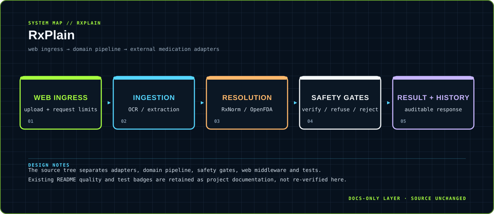
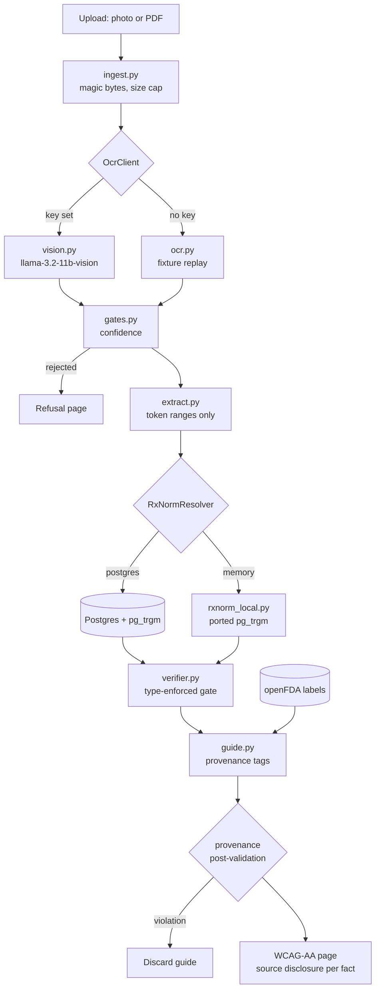

<div align="center">



</div>

# RxPlain

> Safety-first prescription understanding with explicit verification gates.

A Python web and data pipeline organized around ingestion, medication resolution, safety checks, history and user-facing results.

<div align="center">

`Python · FastAPI · PostgreSQL-compatible persistence · web templates` &nbsp;·&nbsp; `Prescription upload → OCR / resolution → safety decision → result`

</div>

## `01 / SYSTEM CARD`

- **Primary boundary:** `web ingress → domain pipeline → external medication adapters`
- **Documentation stance:** architecture and presentation only; application source is intentionally untouched.
- **Visual language:** Y2K terminal grid, brutalist labels, maximalist contrast, readable static SVG fallback.

## `02 / ARCHITECTURE`

The map above is a compact view of the repository's visible runtime boundary. It is designed to answer three questions quickly: where input enters, where policy or domain logic lives, and where external side effects leave the system.


## `03 / DESIGN NOTES`

- The source tree separates adapters, domain pipeline, safety gates, web middleware and tests.
- Existing README quality and test badges are retained as project documentation, not re-verified here.

This upgrade adds documentation assets only. It does not change source files, dependency manifests, tests, workflows or runtime configuration.

## `04 / EXISTING PROJECT DOCUMENTATION`

<details open>
<summary>Read the original project notes</summary>

# RxPlain

[](https://github.com/vigneshsai890/Rxplain/actions/workflows/ci.yml)


**Live demo: <https://rxplain-eight.vercel.app>**

Reads a prescription and explains it in plain language — without ever inventing a
medical fact.

Point a camera at a prescription and RxPlain tells you what each medicine is, its
strength, and when to take it. Every sentence it shows carries a machine-checkable
tag saying where that claim came from. When it cannot confirm something, it says
so instead of guessing.

```
Your prescription
├─ metformin                    RxNorm 6809
│  ├─ "This medicine is metformin."                          [rxnorm:6809]
│  ├─ "The strength on your prescription is 500 MG."         [ocr_span:p1-t003..004]
│  ├─ "Your prescription says to take it twice daily…"       [ocr_span:p1-t011..014]
│  └─ What the official label says                           [openfda:indications_and_usage]
└─ Not verified — ask your pharmacist
   └─ AMOXICILLIN 500 MG CAPSULE   one word scanned at 0.58 confidence
```

---

## The safety model, in one page

The rule this codebase is built around: **a wrong answer is worse than no answer.**

RxPlain generates no medical facts. Drug names, doses and frequencies come only
from OCR text verified against RxNorm, or verbatim from an openFDA drug label.
Nothing is paraphrased into existence.

### Five gates, in order

| # | Gate | Refuses |
|---|------|---------|
| 1 | **Content validation** — media type from magic bytes, never the filename | a ZIP renamed `.png`; anything over the size cap, refused before the body is buffered |
| 2 | **Confidence gates** (`app/safety/gates.py`) | a document whose mean token confidence is below 0.80; individual tokens below 0.60 are flagged |
| 3 | **RxNorm resolution** (`app/adapters/rxnorm.py`) | a drug name RxNorm cannot confirm. Four tiers: exact → normalized → trigram → truncated. A near miss is not a match |
| 4 | **Verbatim traceability** (`app/safety/verifier.py`) | a dose or frequency that is not reproducible from the OCR span it cites |
| 5 | **Provenance post-validation** (`app/domain/guide.py`) | any finished sentence whose dose is not present in the source it names — the whole guide is discarded |

Anything refused becomes *"We couldn't verify this — ask your pharmacist."*

### The type system carries the guarantee

`VerifiedMedication.resolution` is typed `ResolvedConcept`, a distinct type from
`UnresolvedConcept`. `PatientGuide` accepts only `tuple[VerifiedMedication, ...]`.
There is no assignment that puts an unresolved drug inside a patient guide and
still passes `mypy --strict`.

`TracedText.similarity` has a floor of `0.90` in the field definition, so
untraceable text **cannot be constructed** — not merely rejected at runtime.

### Two safety bugs found and fixed during the build

**A fuzzy ratio of ≥ 0.9 is not safe for a dose.** `fuzz.ratio("50 MG", "500 MG")`
is **0.909** and `("500 MG", "500 MCG")` is **0.923**. A ten-fold and a
thousand-fold dose error both cleared a 0.90 threshold. Edit distance is
structurally blind to the characters that carry a dose. Numbers and units are now
compared **exactly** before any fuzzy scoring runs.

**An RxCUI match is not enough to accept a drug label.** openFDA labels carry
*product*-level RxCUIs, and RxNorm correctly relates a combination product to each
of its ingredients — so an RxCUI overlap accepted *ZITUVIMET* (sitagliptin +
metformin) for a plain metformin prescription. A label must now describe exactly
one active substance, and that substance must be the resolved ingredient.

### What is deliberately *not* built

- **Drug-interaction severity.** NLM discontinued the RxNav interaction API on
  2 January 2024 (verified: `/REST/interaction/list.json` returns 404). openFDA's
  `drug_interactions` is one free-text blob with no severity field. Grading
  severity from prose would be generating a medical fact.
- **Expanding sig shorthand** (OD, BD, TDS, HS). "OD" is *once daily* in some
  regions and *right eye* in others; several are on the ISMP error-prone
  abbreviation list. The transcription prompt forbids expansion, and a test
  asserts `TDS` and `PC` survive unexpanded.
- **Cost estimates, allergy cross-sensitivity, pregnancy warnings.** No
  authoritative free structured source exists for any of them.

---

## Architecture



Every external service sits behind a `Protocol` with a working implementation and
a test double: `OcrClient`, `MedicationExtractor`, `RxNormResolver`,
`OpenFdaClient`, `HistoryStore`.

```
app/
├── domain/       ingest, medication, pipeline, guide      pure logic, no I/O
├── safety/       gates, verifier                         the refusal decisions
├── adapters/     ocr, vision, extract, rxnorm,           external seams
│                 rxnorm_local, rxnorm_seed,
│                 openfda, history
├── web/          routes, middleware, limits, ratelimit,   HTTP + rendering
│                 logging, templates/, static/
├── config.py     one Settings model, extra="forbid"
└── db.py         pool + checksum-verified migrations
```

---

## Evidence for the evaluation criteria

| Criterion | Evidence |
|---|---|
| **Code Quality** | `ruff check` and `ruff format --check` clean across 61 files. `mypy --strict` clean with `disallow_any_explicit`, `warn_unreachable`, `extra_checks`. Pydantic strict + frozen models at every boundary. 4,438 lines in `app/`. |
| **Security** | CSP `default-src 'self'`, HSTS, XFO DENY, XCTO nosniff, Referrer-Policy — asserted by tests. Magic-byte validation. Path traversal blocked. Request size ceiling enforced *before* the body is buffered. Per-IP rate limiting, tighter on the expensive endpoint. `SecretStr` on every credential. Parameterised SQL. No PII in logs, enforced by tests. `pip-audit --strict` clean. |
| **Efficiency** | In-process resolution removes a DB round trip per drug; openFDA cache hits measured **1–4ms vs ~2000ms**. 430 tests run in **3.7s**. Container 333MB. |
| **Testing** | **430 tests.** 98% coverage on `app/domain` + `app/safety` (CI floor 85%). **mutmut: 179/179 mutants killed, 0 survived** on `app/safety`. Hypothesis property tests. Golden tests byte-identical on OCR documents and resolution outcomes. |
| **Accessibility** | **axe-core: 0 WCAG 2.1 AA violations** across 5 pages × 4 viewports (320/375/768/1440px), enforced in CI with a real browser. Zero horizontal overflow. Contrast computed from the stylesheet with the WCAG luminance formula. Reading level asserted with `textstat`. |
| **Problem Statement Alignment** | Every patient-facing line carries `{source, ref}` and a disclosure showing the original snippet. Unverifiable items route to a pharmacist. "Not medical advice" on every page. |

CI runs three jobs on every push: quality, mutation testing, and the axe audit.

---

## Run it

```bash
# 1. Install
uv venv --python 3.12 .venv && uv pip install --python .venv/bin/python -e ".[dev]"

# 2. No database needed — resolves from the committed seed in process
STORAGE_BACKEND=memory .venv/bin/uvicorn app.main:app --port 8080
```

Open <http://127.0.0.1:8080>, download a sample prescription from the page, upload
it unchanged.

<details>
<summary>With Postgres (trigram matching in the database)</summary>

```bash
docker compose up -d db
.venv/bin/python scripts/load_rxnorm.py load-seed
.venv/bin/uvicorn app.main:app --port 8080
```
</details>

<details>
<summary>Live transcription instead of fixtures</summary>

Set `NVIDIA_API_KEY` in `.env`. Transcription switches to
`meta/llama-3.2-11b-vision-instruct`. A cold call takes ~45s; a warm one ~3.5s.
Confidence on this path is **self-reported by the model**, not measured — the
model marks words it is unsure of, and those score below the token gate so the
affected medication is withheld.
</details>

```bash
# Quality gate
.venv/bin/ruff check . && .venv/bin/mypy --strict && .venv/bin/pytest --cov
.venv/bin/mutmut run                    # mutation testing on app/safety
cd tools/axe && npm ci && node audit.mjs # accessibility, needs the app running
```

### Demo fixtures

Five committed prescriptions, each exercising a different path. Every image is
stamped *SAMPLE — NOT A REAL PRESCRIPTION*.

| Fixture | Outcome |
|---|---|
| `clean_three_drugs.png` | 3 verified — metformin 6809, lisinopril 29046, atorvastatin calcium 83366 |
| `two_drugs_pdf.pdf` | 2 verified from a PDF |
| `smudged_two_drugs.png` | ibuprofen verified; amoxicillin **withheld** — one token at 0.58 |
| `unknown_drug_and_blank_page.png` | amlodipine verified; ZYNTRAFEX **withheld** — no RxNorm match |
| `illegible_scan.png` | **whole document refused** — mean confidence 0.639 < 0.80 |

---

## Data sources

All drug data is real. Nothing is authored here.

- **RxNorm** — US National Library of Medicine. 310 concepts and 2,721
  ingredient→product relations, fetched from the public RxNav API by
  `scripts/fetch_rxnorm_seed.py` and committed with source and timestamp.
  `scripts/load_rxnorm.py load-rxnconso` loads a full licensed `RXNCONSO.RRF`.
- **openFDA** — FDA drug label sections, quoted verbatim, never reworded.

---

## Not medical advice

RxPlain repeats what is on a prescription and what the official drug label says.
It does not give medical advice and cannot say whether a medicine is right for
anyone. It never suggests changing, skipping or replacing a dose. Always follow
your own doctor or pharmacist.

</details>

